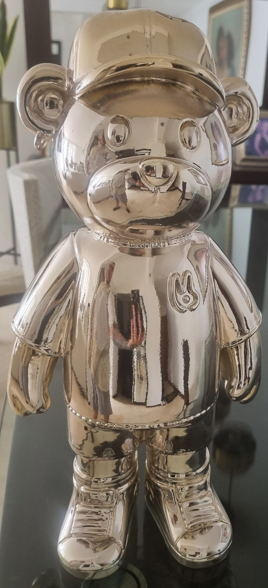
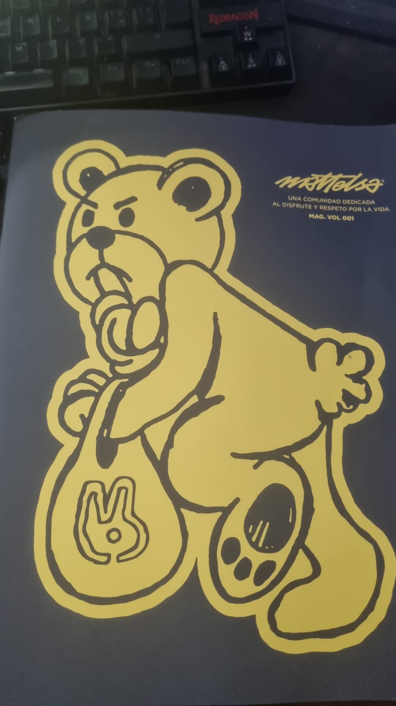
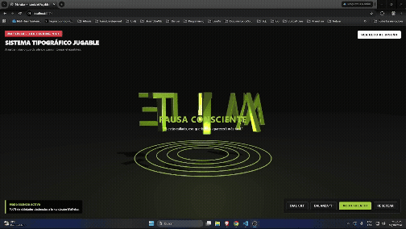
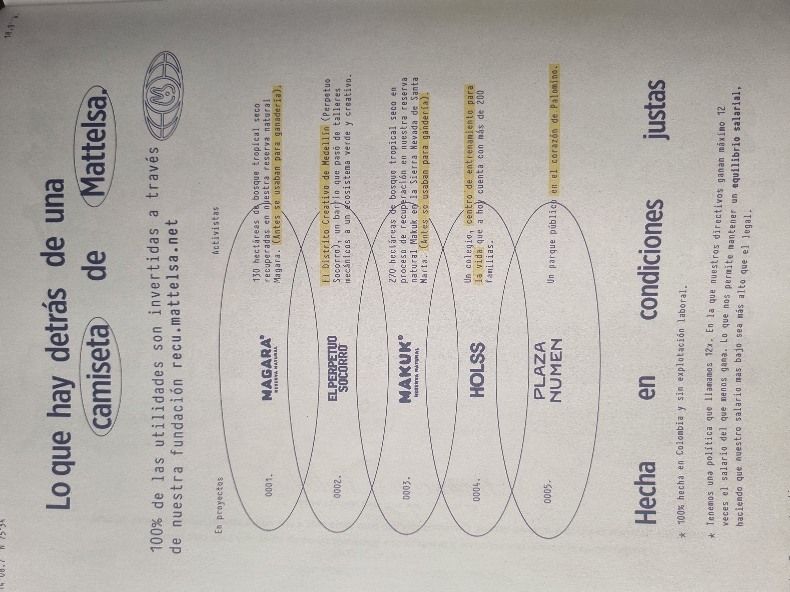
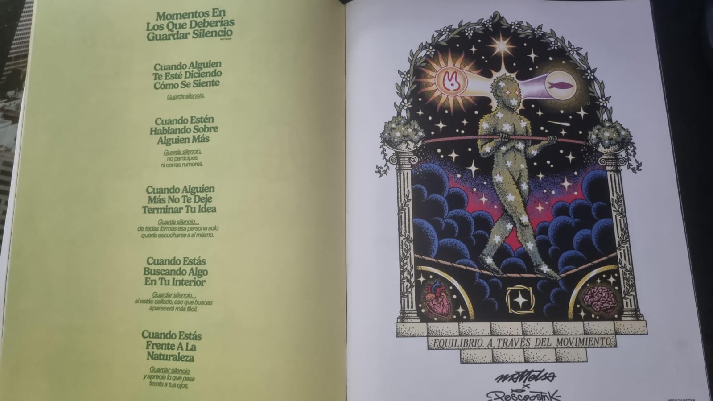

# 🌊 Unidad 7: Tipografia jugable

**Texto Guia:** Capítulo 6 - Autonomous Agents [The Nature of Code](https://natureofcode.com/physics-libraries/)
**Herramienta de desarrollo:** three.js / JavaScript

## Propósito

Diseñar un sitema tipografico jugable que permita explorar la identidad de una empresa mediante las letras de su nombre

## Actividad 01: referentes y posibilidades de los sistemas jugables

- 📹[Word as image de Ji Lee](https://pleaseenjoy.com/word-as-image/)
- 📹[Playables](https://playables.net/)
- 📹[Bibliotecas de física — The Nature of Code](https://natureofcode.com/physics-libraries/)
- 📹[Matter.js: ejemplos y documentación](https://brm.io/matter-js/)
- 📹[Rapier](https://rapier.rs/docs/)
- 📹[What the font?!?!](https://youtu.be/d0GgzjCFWq0?si=dS2i1s939WYP0qU2)
- 📹[EX8 by Patrik Hübner](https://www.patrik-huebner.com/creative-coding/ex8/)
- 📹[Input → Physics by Patrik Hübner](https://www.patrik-huebner.com/input/physics/)
- 📹[FROM PAPER TO SCREEN](https://vimeo.com/69375692)
- 📹[FUTURA LE SPECIMEN ANIME](https://vimeo.com/33434885)
- 📹[Dynamic Typography: Bringing Text to Life via Video Diffusion Prior](https://animate-your-word.github.io/demo/)
- 📹[Diseñar un sistema capaz de producir animaciones](https://2026.typographics.com/conference/kiel-d-mutschelknaus)
- 📹[SPACE TYPE GENERATOR v.field : Variations Demo](https://vimeo.com/294650043)
- 📹[typeChaosifier Dev Valladares](https://valladares.dev/typechaosifier)

## Actividad 02: encargo de diseño

Elige una empresa u organización y precisa:

### Inspiración del Proyecto

**Empresa: Mattelsa**

Aprovechando que tengo una revista de mattelsa y un artoy que me gane anteriormente los use como referente conceptual y visual.

Entonces en una pagina de la revista encontre encontre que tienen varios proyectos Magara y Makuk son dos reservas naturales, que se dedican a recuperar el bosque tropical seco que se usaban para ganaderia

y me gusto otra ilustracion que dice Equilibrio a traves del movimiento, podemos observar un humano hecho de naturaleza, sobre la cuerda floja y al lado una pagina que indica en que momentos hay que guardar silencio siendo uno Cuando estas frente a la naturaleza, y este mensaje se convirtio en la inspiracion para desarrollar el reto

- 📹[MATTELSA: 25 años de lecciones sin filtros en 100 minutos](https://youtu.be/9fqRMGzvttI?si=EoYjNV642ER23H3y)

1. Qué hace y a qué público se dirige.

   **Qué hace: Compañía colombiana de streetwear y comunidad enfocada en la cultura de bienestar, el consumo consciente y la transformación social/ambiental**

   **Público: Adultos jovenes con pensamiento crítico, interesados en el diseño minimalista/brutalista, la sostenibilidad, la cultura de calle y el desarrollo personal.**

2. Qué atributo de su identidad quieres comunicar y en qué te basas para elegirlo.

   **Atributo: Sintonía y Equilibrio.**

   **Fundamento: Basado en la gráfica de las pantallas CRT ("Mantén el equilibrio") y el diagrama Ego vs. Ser Supremo de su revista. En un entorno saturado de ruido y consumo excesivo, Mattelsa propone un dia de pausa y alineación personal.**

3. Dónde se utilizaría la pieza: por ejemplo, una portada web, una presentación o una pantalla en un evento.

   **Ubicación: Hero interactivo / Portada web principal (mattelsa.net) o pantalla táctil interactiva para la zona de experiencia y descanso en sus tiendas físicas.**

4. Qué podrá hacer la persona y qué reglas darán sentido a esas acciones.

   **Todas las geometrías en pantalla nacen exclusivamente de las letras M - A - T - T - E - L - S - A: Transformación Tipográfica Procedural**

   **Acción: Arrastrar o rotar las letras en el espacio 3D**

5. Qué relaciones o consecuencias esperas que pueda descubrir jugando.

   **El silencio revela el propósito: La pausa y el silencio descubren el impacto real de la marca**

## [Enlace Demo](https://mattelsa-tipografia.vercel.app/)
