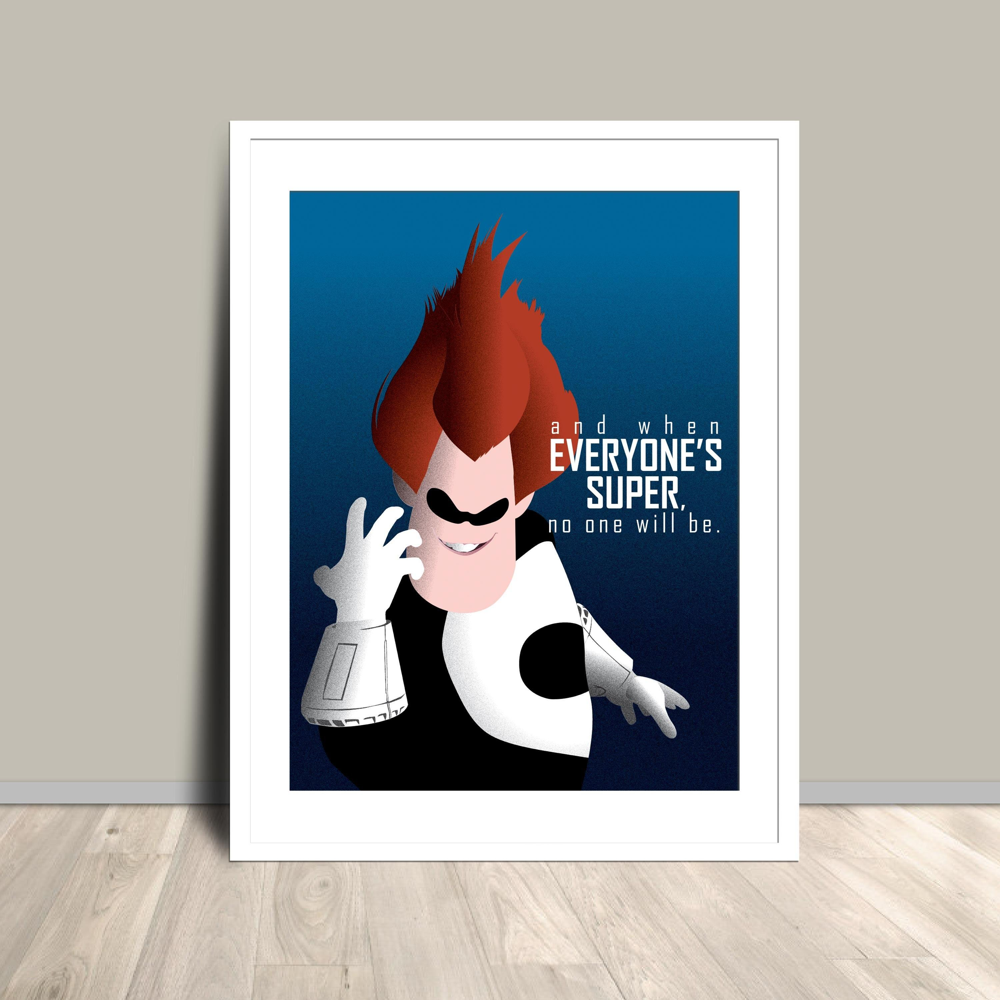

# 🌊 Unidad 8: Why Bother? ¿Para qué tomarte el trabajo?

## Actividad 01: Why Bother? ¿Para qué tomarte el trabajo?

- 📹[Robert Hodgin: Why Bother? Making Art in the Age of AI.](https://www.youtube.com/watch?v=vmUodu6K-bA)

### ¿Qué idea de la charla te hizo pensar en tu propia experiencia durante el curso?

- Durante el curso nos enfocamos en el resultado final, la entrega producto vs proceso, aunque al principio presentamos un examen el cual nos ayuda a interiorizar mas estos conceptos y ayuda a consolidar el proceso, entiendo que no se pudo seguir haciendo por dificultades de coordinacion, pero en mi proceso siempre hubo una idea inicial la cual se itero con la ayuda de la ai nunca entregue el primer resultado por que nunca estuve satisfecho con los resultados, por que siempre veia que era mejorable todo lo que hacia, me comparo constantemente con el contenido de mis redes sociales y eso me estresa pero luego recuerdo, por que me estreso si actualmente no pago ningun modelo de AI para obtener mejores resultados y muchos de estos contenidos de internet integran flujos de AI con minimo dos herramientas de pago, hago lo que puedo mientras aprendo, pero si tuviera claude code haria maravillas.

### ¿Qué significa para ti aprender algo cuando puedes obtener un resultado sin comprender cómo se construyó?

- Para mi este punto de vista es simplista y requiere el minimo esfuerzo, se acerca mas al del usuario y no al desarrollador, a un usuario de netflix no le importa como esta hecha la plataforma, donde esta alojada la base de datos o si tiene buenas practicas de codigo limpio solo le importa que tengan la pelicula o serie que desea ver, alguien comun que paga un servicio de uber no le intereza que algoritmo usa uber para calcular la tarifa de su viaje, ni le interesa como calcula las rutas y el timpo, solo le importa que llegue un conductor lo mas rapido posible, este tipo de enfoque se acerca mas al del usuario y corre el riesgo de que todo lo que construimos sin saber como funciona termine siendo generico y repetitivo todo mundo lo puede hacer pero nadie sabe cual seria la mejor manera de evolucionarlo, alguien que realmente le interese aprender un tema primero lo define y lo conocer para luego explorarlo.

### ¿Qué diferencia encuentras entre cumplir una tarea y explorar algo por curiosidad?

- Cumplir una tarea se hace por obligacion mientras que explorar por curiosidad nos da la facultad de decidir hacia donde dirigir esa busqueda para comprender algo nuevo que podamos asociar con nuestra realidad.

### ¿Qué esfuerzo consideras valioso y por qué?

- Considero la creatividad valiosa, ya que es una habilidad que cualquier persona puede desarrollar y no una bombilla que se enciende por arte de magia en situaciones especificas, la creatividad requiere disciplina y pensamiento, innovamos a traves de unir dos cosas que aparentemente no estan relacionadas para solucionar un problema o necesidad de alguna entidad.

### Si revisas tus autoevaluaciones, ¿Reconoces tu experiencia en lo que dicen? ¿Te detuviste a examinar tu aprendizaje o delegaste el juicio sobre lo que aprendiste?

- Siempre me tome la tarea de buscar referentes, en la primera actividad hasta de entender el codigo y decirle a la ia que simplificara la experiencia por algo que pudiera entender, pero nunca me detuve analizar si en verdad estoy aprendiendo, en esta modernidad liquida donde se valora mas la velocidad por entregar y estas metricas miden nuestra eficiencia, es facil crear un sesgo de aprendizaje.

## Actividad 03: presentar la exploración

### EVERYONE IS CREATIVE

### Producir algo no es lo mismo que tener algo que decir

#### ¿Cómo interpretaste la pregunta Why Bother? ¿Qué aspecto decidiste explorar y cómo cambió tu interpretación mientras trabajabas?

- La facilidad de producir contenido y la dificultad de crear algo significativo
- Demos fallidos:
  - [Somos la vacas del futuro](https://vaquitas-mecha-y-flora.lovable.app/)
  - [Tres actos](https://pl3vuixxgcn5k.kimi.page/)

### ¿Cómo lo exploraste? ¿Qué técnicas elegiste, qué decisiones tomaste y qué pruebas orientaron el desarrollo?

- Tome referencias como Syndrome el villano de los increibles (Y cuando todos sean super, nadie lo sera)
  

- [The full-length interview with Yuval Noah Harari](https://youtu.be/FNZhxTtOL-I?si=AB94bOGSObpNfkDT)
  ¿Somos las vacas del futuro?, Para mi ya lo somos, la IA no nos convierte en vacas, solo hace evidente que llevamos mucho tiempo siendolo. Si una persona comun no entiende como se calcula una tasa de interes, como funciona el codigo penal o como se estructura una campaña publicitaria que influye en nuestras decisiones, entonces este sintoma ya existia mucho antes de la AI

- Modernidad Liquida de Zygmunt Bauman metafora La era de la modernidad solida ha llegado a su fin. por que los solidos, a diferencia de los liquidos, conservan su forma y persisten en el tiempo. En cambio, los liquidos se transforman constantemente.

### ¿Qué encontraste? ¿Qué ocurrió como esperabas, qué te sorprendió y qué sigue abierto?

- La abundancia puede reducir la percepcion de valor y como pierde significado cuando se automatiza.

### ¿Qué aprendiste realmente? ¿Qué puedes comprender, explicar o modificar ahora?

- Aprendi a explorar ideas abstractas mediante algoritmos, diseñar una experiencia que comunique una idea concreta

### ¿Qué sentido tuvo tomarte el trabajo? ¿Qué te hizo continuar, qué esfuerzo consideraste valioso y cómo te sitúas ahora frente a la pregunta de Hodgin?

- construir una experiencia que haga visible una contradiccion, mi postura es la misma hay miles de personas que no saben que es claude, agentes, skills, command line interface y son felices, por que me voy a estresar por el avance de la AI para automatizar mis tareas, Algunas personas seguiran con el habito del doomscrolling, y yo espero estar al otro lado.
